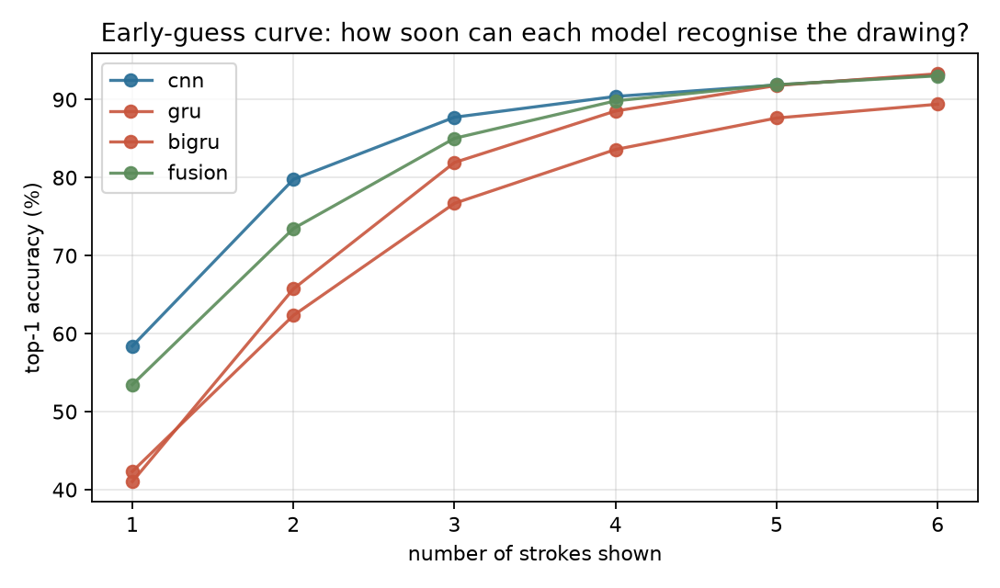
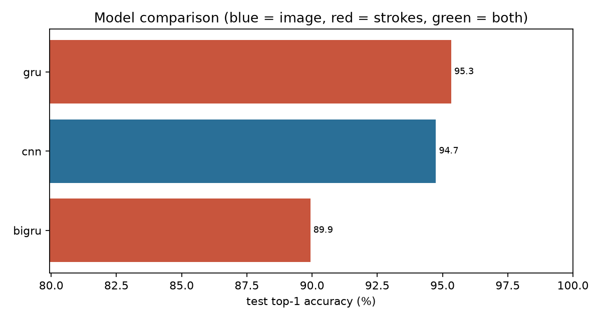

# Quick, Draw! Sketch Recognition: Does Seeing *How* a Sketch Is Drawn Help?

A controlled benchmark of 8 deep learning architectures (ANN, CNN, LSTM, BiLSTM, GRU, BiGRU, Conv1D-BiGRU and a CNN+GRU fusion model) on a **balanced 10-class, 100,000-drawing subset** of Google's [Quick, Draw!](https://github.com/googlecreativelab/quickdraw-dataset) dataset.

> **Research question:** Does a model that sees the *stroke sequence* (how a doodle was drawn) classify better than one that only sees the *final image*, and how early in the drawing can it guess correctly?

<!-- TODO: add demo GIF or Hugging Face Spaces link here -->

## Results

<!-- TODO: paste results/results_table.md here after training -->

| Model | Input | Top-1 | Top-3 | Macro-F1 | Params | Latency (ms) |
|---|---|---|---|---|---|---|
| ... | ... | TODO | TODO | TODO | ... | ... |

Key plots (generated into `results/`):

| Early-guess curve | Model comparison |
|---|---|
|  |  |

**Key findings** (fill in from your real numbers):
1. TODO: best model and its top-1 / top-3 accuracy.
2. TODO: sequence vs image result (which wins, by how much).
3. TODO: accuracy after only the first 1-3 strokes, sequence vs image.
4. TODO: most confused class pair (see confusion matrix) and why.

## Dataset

| Property | Value |
|---|---|
| Source | Quick, Draw! *simplified* `.ndjson` files |
| Classes (10) | cat, dog, car, bus, airplane, house, tree, flower, apple, clock |
| Samples | 10,000 per class = 100,000 total (**perfectly balanced**) |
| Split | Stratified 70 / 15 / 15 (7,000 / 1,500 / 1,500 per class) |
| Filtering | Only drawings with `recognized == True` (the game's own AI guessed them) |

Classes were chosen deliberately: cat/dog and car/bus are visually confusable pairs, so the error analysis has substance.

Each drawing is stored in two representations built from the **same strokes**, so the comparison is fair:

* **Image:** 28x28 grayscale, rendered from the strokes.
* **Sequence:** up to 100 points of `(dx, dy, pen_lift)`, padded and handled with packed sequences.

## Models

| Track | Model | Input | Idea |
|---|---|---|---|
| A | ANN | image | Flatten, 2 dense layers (baseline) |
| A | CNN | image | 3 conv blocks with BatchNorm and MaxPool |
| B | LSTM / BiLSTM | strokes | 2-layer recurrent net over the stroke sequence |
| B | GRU / BiGRU | strokes | Lighter gated alternative |
| B | Conv1D-BiGRU | strokes | Conv1D for local stroke shapes, BiGRU for order |
| C | Fusion | both | CNN branch + BiGRU branch, features concatenated |

Same split, same seed, same optimiser (Adam, lr 1e-3), same LR scheduler, same early-stopping rule for every model.

## Project structure

```
quickdraw-sketch-dl/
├── README.md
├── requirements.txt
├── app.py                 # Gradio demo
├── src/
│   ├── data.py            # download, filter, balance, render, split
│   ├── models.py          # all architectures
│   ├── train.py           # training loop, early stopping, metrics.csv
│   ├── evaluate.py        # tables, confusion matrix, early-guess, learning curve
│   └── utils.py
├── results/               # metrics.csv, plots (committed)
├── data/                  # created by src.data (git-ignored)
└── checkpoints/           # created by src.train (git-ignored)
```

## How to run

```bash
pip install -r requirements.txt

# 1. Build the balanced dataset (downloads ~10 category files)
python -m src.data --per-class 10000

# 2. Train all 8 models (use a GPU, e.g. Google Colab)
python -m src.train --model all --epochs 25

# 3. Tables, confusion matrix, error gallery, curves
python -m src.evaluate --all

# 4. Extra experiments
python -m src.evaluate --early-guess --models cnn gru bigru fusion --n-eval 3000

# Learning curve: train on fewer samples per class, then plot
python -m src.train --model cnn   --train-per-class 1000 --tag _1k
python -m src.train --model cnn   --train-per-class 2000 --tag _2k
python -m src.train --model cnn   --train-per-class 5000 --tag _5k
python -m src.train --model bigru --train-per-class 1000 --tag _1k
python -m src.train --model bigru --train-per-class 2000 --tag _2k
python -m src.train --model bigru --train-per-class 5000 --tag _5k
python -m src.evaluate --learning-curve --models cnn bigru

# Pen-lift ablation
python -m src.train --model bigru --no-pen-lift --tag _nopen

# Demo
python app.py
```

**Google Colab:** upload the folder (or clone your repo), run `!pip install -r requirements.txt`, pick *Runtime, Change runtime type, GPU*, then run the commands above with a `!` prefix.

## Experiments

| Experiment | What it shows |
|---|---|
| Early-guess curve | Accuracy when only the first k strokes are shown (sequence models can do this naturally) |
| Learning curve | Data efficiency with 1k / 2k / 5k / 7k training samples per class |
| Pen-lift ablation | Whether stroke boundaries matter for the sequence models |

## Limitations and future work

* 28x28 images lose fine detail; higher resolutions could help the CNN.
* Quick, Draw! labels are noisy even after the `recognized` filter.
* The web demo uses the image model only, because a plain canvas does not expose stroke timing.
* Next steps: attention or a Transformer over strokes, more classes, data augmentation, live stroke-level prediction in the browser.

## Acknowledgements

Data: [Google Quick, Draw!](https://github.com/googlecreativelab/quickdraw-dataset), released under CC BY 4.0.
